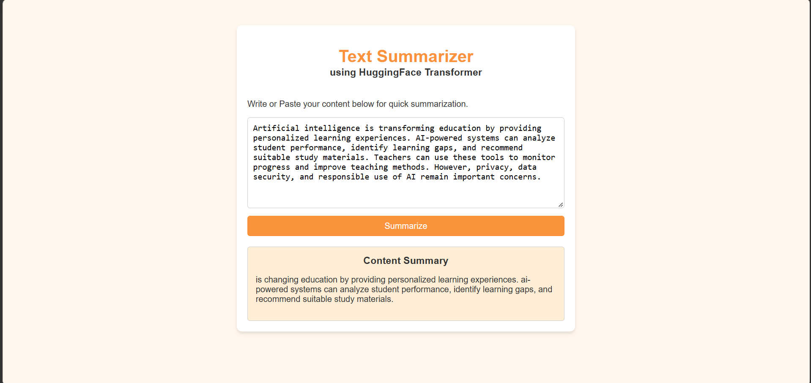

# Summarizer-HF

**Text Summarizer App — Transformer Minor Project using Hugging Face and FastAPI**

## Overview
Summarizer-HF is an AI-powered web application that generates concise summaries from longer text using a fine-tuned T5 Transformer model.

## Application Screenshot



## Features
- Text input through a simple web interface.
- Automatic text summarization using a T5 model.
- Backend API built with FastAPI.
- HTML-based user interface.
- PyTorch-powered model inference.

## Technologies Used
- Python
- Hugging Face Transformers
- T5 Transformer
- PyTorch
- FastAPI
- HTML and Jinja2

## Project Structure
```text
Summarizer-HF/
├── app.py
├── index.html
├── saved_summary_model/
├── README.md
└── .gitignore
```

## Run Locally

1. Clone the repository:
   ```bash
   git clone https://github.com/YOUR-USERNAME/Summarizer-HF.git
   cd Summarizer-HF
   ```

2. Install the required dependencies:
   ```bash
   pip install fastapi "uvicorn[standard]" transformers sentencepiece jinja2 torch
   ```

3. Start the application:
   ```bash
   python -m uvicorn app:app --reload
   ```

4. Open `http://127.0.0.1:8000` in your browser.

**Note:** The `saved_summary_model/` directory must contain the model and tokenizer files expected by the application.
